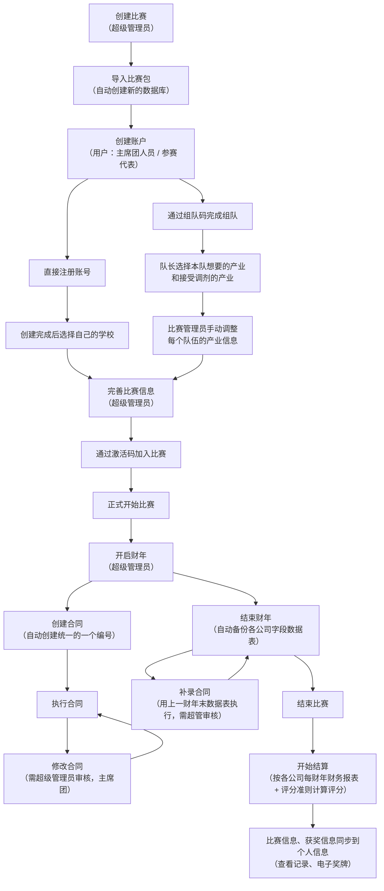
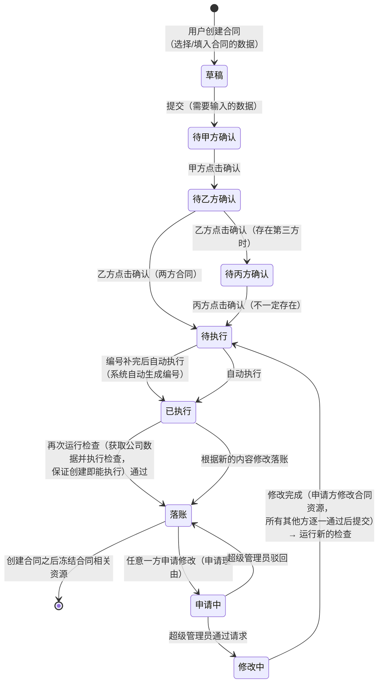
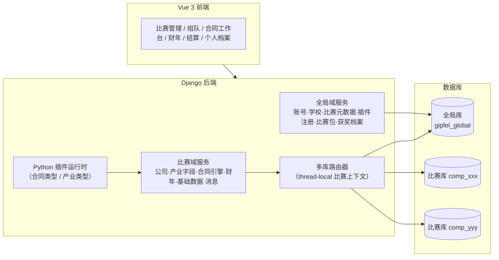
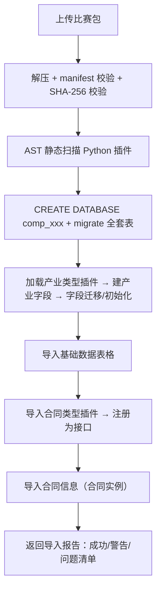
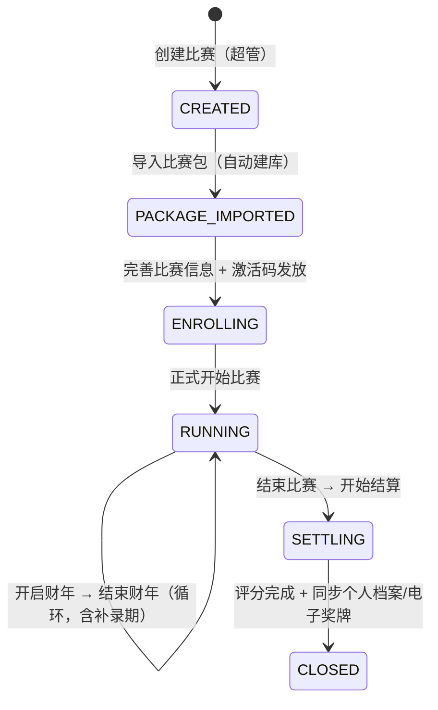
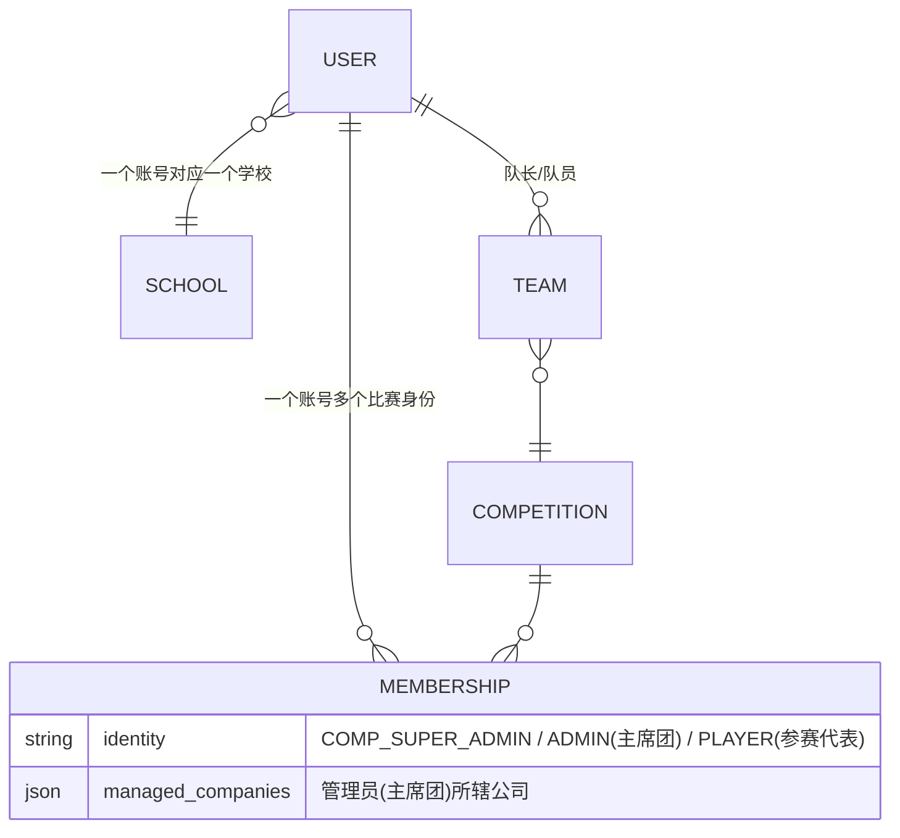

# Gipfel 商业竞争管理系统 — 全项目重构方案

> 依据文件：`比赛流程.svg`、`合同状态机.svg`
> 技术栈：Django（DRF + Channels）+ Vue 3 —— 全流程推倒重写，历史数据不迁移
> 文档版本：v1.1（新增日志体系 §14；跟进项见 [§18](#18-待确认问题清单)）

---

## 目录

1. [文档说明与决策记录](#1-文档说明与决策记录)
2. [目标业务流程（比赛流程图完整解读）](#2-目标业务流程)
3. [合同状态机（合同状态机图完整解读）](#3-合同状态机)
4. [现状盘点与差距分析](#4-现状盘点与差距分析)
5. [目标架构总览](#5-目标架构总览)
6. [数据模型设计](#6-数据模型设计)
7. [合同引擎与落账设计](#7-合同引擎与落账设计)
8. [Python 插件规范（合同类型 / 产业类型）](#8-python-插件规范)
9. [比赛包（Package）格式与导入机制](#9-比赛包格式与导入机制)
10. [比赛生命周期与财年编排](#10-比赛生命周期与财年编排)
11. [结算、评分与电子奖牌](#11-结算评分与电子奖牌)
12. [API 设计概览](#12-api-设计概览)
13. [前端设计（Vue）](#13-前端设计vue)
14. [日志体系（字段日志 / 网络日志）](#14-日志体系字段日志--网络日志)
15. [权限与账号体系](#15-权限与账号体系)
16. [实施路线图](#16-实施路线图)
17. [风险与对策](#17-风险与对策)
18. [待确认问题清单](#18-待确认问题清单)

---

## 1. 文档说明与决策记录

### 1.1 已确认的关键决策（与需求方逐项确认）

| # | 决策点 | 结论 |
|---|--------|------|
| D1 | 「自动创建新的数据库」的粒度 | **每场比赛一个独立数据库**。导入比赛包时自动创建该比赛专属数据库，服务端动态路由切换 |
| D2 | 合同类型 / 产业类型 Python 文件的执行方式 | **服务端直接加载执行 Python 插件**（受信任环境，上传权限严格管控 + 全量审计） |
| D3 | 账号与身份体系 | 系统级只有**超级管理员**与**用户**；比赛内身份为**超级管理员 / 管理员（主席团使用）/ 参赛代表**；**一个账号可持多个比赛身份**（A 在比赛 1 是管理员、在比赛 2 是参赛代表），共用一套用户名密码；新增**学校**实体，一个账号对应一个学校；新增**组队码、激活码**机制；队长选择产业与接受调剂的产业 |
| D4 | 合同确认顺序 | **N 方按参与方顺序依次确认**（丙方只是三方合同的第三参与方，可扩展任意方数） |
| D5 | 编号与执行 | **系统自动生成统一合同编号**，编号生成（补完）后**自动执行**合同 |
| D6 | 修改合同的落账处理 | **回滚旧落账 → 按新内容重新检查 → 重新落账**（沿用不可变效果审计 + 重放机制思路） |
| D7 | 重构范围与方式 | **全流程全部重写**（含组队、激活码、财年、补录合同、结算评分、电子奖牌），Django + Vue 技术栈，历史数据不迁移 |
| D8 | 修改流程「其他方通过」规则 | **所有其他方逐一通过**后方可提交修改；超管驳回则回到落账态 |
| D9 | 比赛内超级管理员 | 由**系统超级管理员指派**，**可多人** |
| D10 | 落账冻结范围 | **字段级**：仅冻结合同效果触及的（公司, 字段），其余字段照常可改 |
| D11 | 评分准则 | 需求方**稍后提供细则/表格**；评分引擎先做可配置框架，收到细则后建模 |
| D12 | 电子奖牌 | **仅在线展示**（个人档案内查看获奖记录与奖牌样式，不提供下载文件） |
| D13 | 统一合同编号格式 | **类别前缀-比赛代码-财年-流水号**（如 `PO-2025-FY1-0001`） |
| D14 | 补录合同时限 | **不限时间，可随时对任意已结束财年补录**，均需超级管理员审核 |
| D15 | 比赛包表格模板 | 尚无现成模板，由**我方在 M1 前产出《比赛包格式规范》**（表格字段定义 + 示例包）供需求方确认 |
| D16 | 旧项目处置 | **只读归档留存**：旧代码打 tag 封存、旧库导出备份，新项目另起目录 |
| D17 | 日志体系 | 日志分**字段日志**与**网络日志**两类；**所有日志**必含**用户（系统级）、设备信息、时间**；字段日志**值变更 + 结构变更都记**（含变更前后值、来源动作、操作者） |
| D18 | 网络日志粒度 | **请求元数据 + 脱敏摘要**（方法/路径/状态码/耗时/IP/设备/用户 + 请求响应脱敏摘要；密码/token/邀请码原文一律不入日志） |
| D19 | 设备信息 | **设备实体 + 日志内联快照**：登录登记设备（UA/系统/浏览器/屏幕/IP），日志引用设备 ID 并冗余快照 |
| D20 | 日志留存 | **分级存储 + 只增不删**：网络日志存全局库、字段日志存比赛库（随比赛归档）；仅超管可导出；保留期可配置（默认 3 年） |

### 1.2 名词表

| 名词 | 含义 |
|------|------|
| 比赛包 | 一次导入即搭建整场比赛数据底座的标准压缩包：Python 插件 + 标准格式表格文件 |
| 合同类型（Python 文件） | 定义一类合同的参与方、输入、检查逻辑与字段修改逻辑的 Python 插件 |
| 产业类型（Python 文件） | 定义一个产业的字段、公式、数据类型、初始值的 Python 插件 |
| 落账 | 合同执行产生的字段改写正式生效并记账（不可变审计 + 可回滚） |
| 实体信息表 / 财务报表 | 产业字段的两类数据表：实体信息表记录实体状态，财务报表按财年记录账目 |
| 补录合同 | 财年结束后录入的合同，以「上一财年末数据表」为基准执行 |
| 主席团 | 比赛内「管理员」身份的使用方，负责管理所辖公司的合同并影响产业字段 |
| 组队码 / 激活码 | 分别用于参赛代表组队、加入比赛的一次性/限次邀请码 |

---

## 2. 目标业务流程

以下为 `比赛流程.svg` 的完整解读，按阶段展开（与图中节点一一对应）。

### 2.1 流程总览



### 2.2 逐阶段说明

#### 阶段一：创建比赛（操作者：超级管理员）

比赛详情页需要承载的信息（图中明确列出）：

- 比赛**展示图片**
- 比赛**名称**
- **办赛学校**
- 比赛**地点**
- 比赛**人员安排信息**

> 现状对比：现有 `Competition` 模型只有 name / status / mapBackground / stockConfig，缺少展示图片、办赛学校、地点、人员安排，需全部新建。

#### 阶段二：导入比赛包（自动创建新的数据库）

比赛包内容与行为（图中明确列出）：

| 包内容 | 系统行为 |
|--------|----------|
| （整个包） | **自动创建新的数据库** —— 为该比赛创建独立数据库并迁移出全套数据表 |
| **合同信息** | 被系统**自动导入**并**暴露为接口**；合同点击执行时**传入参与方信息**，按合同内容执行，**修改参与方数据库字段内容** |
| **产业信息、产业字段** | **自动更新并迁移数据库**（字段结构变化只影响本比赛库） |
| 燃料、仓库、载具、地图、原料、产品、零件、基建、科技树、生产线信息 | 作为基础数据导入本比赛库 |
| **合同类型 = 一个个 Python 文件** | 包含合同对字段的**修改**与对字段的**检查** |
| **产业类型信息 = Python 文件** | 定义产业**字段、公式、数据类型、初始值**等 |
| 上述信息的**标准格式表格文件** | 数据载体（表格 = 数据，Python = 逻辑） |

#### 阶段三：创建账户（操作者：用户）

- 账户类型：**主席团人员**、**参赛代表**
- 两条入口：
  - **直接注册账号**（注册完成后**选择自己的学校**）
  - **通过组队码完成组队**（参赛代表以组队码加入队伍）
- 组队后：**创建队伍的人（队长）选择该队伍想要的产业和接受调剂的产业**
- **比赛管理员手动调整每个队伍的产业信息**（最终产业分配由管理员定夺）
- **比赛管理员手动调整每个主席团人员的管理公司**（主席团成员 ↔ 所辖公司 的指派）

> 超级管理员职责补充（需求方口述）：超级管理员**管理队伍的产业**，并**管理「申请成为管理员的账号」所管辖的公司**（即对管理员账号的公司管辖范围做审批与分配）。

#### 阶段四：完善比赛信息与加入比赛

- **完善比赛信息**（超级管理员）
- **通过激活码加入比赛**（用户凭激活码加入对应比赛并获得比赛内身份）

#### 阶段五：开赛与财年

- **正式开始比赛**
- **开启财年**（超级管理员）
- 财年期间：
  - **创建合同**：产业字段包含多个「数据表」——**实体信息表**和**财务报表**；合同**自动创建统一的一个编号**
  - **执行合同**：点击执行传入参与方信息，按合同内容修改参与方字段
  - **修改合同**：**需要通过超级管理员的审核**，由**主席团**发起（详细状态机见 §3）
- **结束财年**：**财年结束后自动备份一次各公司字段数据表**
- **补录合同**：
  - 使用**上一财年末的数据表**进行执行
  - **非财年定时器字段要自动同步修改信息**
  - **需要超级管理员审核**

#### 阶段六：结束比赛与结算

- **结束比赛**
- **开始结算**：按照各个公司的**每财年财务报表**，并按照**评分准则**进行**评分计算**
- **将比赛信息、获奖信息同步到个人信息**：可**查看记录**、**电子奖牌**等内容

---

## 3. 合同状态机

以下为 `合同状态机.svg` 的完整解读。

### 3.1 状态图



### 3.2 状态定义

| 状态 | 含义 | 进入条件 | 关键备注 |
|------|------|----------|----------|
| `DRAFT` 草稿 | 合同创建，录入数据 | 用户创建合同 | **需要输入的数据：选择/填入合同的数据**（参与方、参数） |
| `PENDING_PARTY_1..N` 待甲方/乙方/丙方确认 | 按参与方顺序逐方确认 | 上一方点击确认 | **N 方按参与方顺序依次确认**；「丙方」= 第 3 参与方，**不一定存在**；两方合同无丙方环节 |
| `PENDING_EXEC` 待执行 | 确认完毕，等待编号 | 全部参与方确认完成 | **系统自动生成统一编号**；**编号补完后自动执行** |
| `EXECUTED` 已执行 | 合同逻辑已执行 | 自动执行完成 | 执行时**传入参与方信息**，**按合同内容修改参与方数据库字段内容** |
| `POSTED` 落账 | 效果正式生效并记账 | **再次运行检查**（获取公司数据并执行检查）通过 | **创建（落账）之后冻结合同相关资源**；**保证创建即能执行** |
| `MOD_APPLYING` 申请中 | 任一方发起修改申请 | **任意一方申请修改**，需填写**申请理由** | 待**超级管理员**审核 |
| `MOD_EDITING` 修改中 | 修改申请通过 | **超级管理员通过请求** | **申请方修改合同数据/合同资源**；**所有其他方逐一通过申请**（任一方驳回 → 回到落账态） |
| （回到待执行） | 修改完成 | 修改定稿 → **运行新的检查** | 检查通过 → 自动执行 → **根据新的内容修改落账**（回滚旧落账后重新落账） |

### 3.3 转移触发与守卫（实现用转移表）

| # | From | 事件 | 守卫 / 前置检查 | To | 副作用 |
|---|------|------|-----------------|-----|--------|
| T1 | `*` | `create` | 参与方与输入满足 inputSchema | `DRAFT` | 生成合同记录（未编号） |
| T2 | `DRAFT` | `submit` | 运行合同 `check()`（保证创建即能执行） | `PENDING_PARTY_1` | 通知第 1 参与方 |
| T3 | `PENDING_PARTY_i` | `confirm(party_i)` | 操作者为 party_i 本人 | `PENDING_PARTY_{i+1}` / `PENDING_EXEC` | 记录确认时间与确认人 |
| T4 | `PENDING_EXEC` | `numbering_completed` | 系统生成统一编号 | `EXECUTED`（自动） | 写入统一编号，立即自动执行 |
| T5 | `EXECUTED` | `recheck` | **再次运行检查**（取公司当前数据执行检查）通过 | `POSTED` | 冻结合同相关资源 |
| T6 | `POSTED` | `request_modify(reason)` | 任意参与方；须填写申请理由 | `MOD_APPLYING` | 通知超级管理员 |
| T7 | `MOD_APPLYING` | `approve` | 操作者为超级管理员 | `MOD_EDITING` | 解冻合同相关资源（仅申请方可改） |
| T7' | `MOD_APPLYING` | `reject` | 操作者为超级管理员 | `POSTED` | 记录驳回意见 |
| T8 | `MOD_EDITING` | `other_party_approve` | **所有其他方逐一通过**（缺一不可） | 保持 `MOD_EDITING` | 记录各其他方确认 |
| T8' | `MOD_EDITING` | `other_party_reject` | 任一其他方驳回 | `POSTED` | 记录驳回意见，合同保持原落账 |
| T9 | `MOD_EDITING` | `submit_changes` | 全部其他方已通过；**运行新的检查**通过 | `PENDING_EXEC` | 回滚旧落账（按效果审计重放），重新进入执行流 |
| T10 | `PENDING_EXEC`（修改后） | 自动 | 编号（沿用/重编）补完 | `EXECUTED` → `POSTED` | **根据新的内容修改落账** |

### 3.4 关键语义约定

1. **编号**：全系统**自动创建统一的一个编号**（格式定稿 D13：`合同类别前缀-比赛代码-财年-流水号`，如 `PO-2025-FY1-0001`），编号在「确认链完成」时生成，生成即触发自动执行。
2. **执行 = 落账前的字段改写**：执行时传入参与方信息，按合同内容（Python 插件 `apply()`）修改参与方数据库字段；**落账**时**再次运行检查**（获取公司数据并执行检查）——即「执行产生效果、检查保证正确、落账冻结生效」。
3. **冻结**：落账后**冻结合同相关资源**（合同涉及的参与方公司字段被锁定，禁止其他途径修改），直到修改流程解冻。
4. **修改 = 回滚 + 重做**：修改完成提交后**回滚旧落账**（按不可变效果审计重放复原），**运行新的检查**，自动执行，**根据新的内容修改落账**。
5. **补录合同**：**不限时间，可随时对任意已结束财年补录**（决策 D14），走同一状态机，但：① 以**所补录财年末的数据表（备份快照）**为执行基准（即图中「上一财年末的数据表」）；② **非财年定时器字段自动同步修改信息**；③ **需要超级管理员审核**（增加一道超管审核守卫，建模为 `BACKFILL_REVIEW` 审核态，通过后进入 `DRAFT` 确认链）。

---

## 4. 现状盘点与差距分析

| 能力域 | 现状（旧项目） | 目标（重构后） | 差距级别 |
|--------|----------------|----------------|----------|
| 数据隔离 | 单库（SQLite/PostgreSQL）+ `competitionId` 租户列 | **每场比赛独立数据库**，动态路由 | 🔴 重写 |
| 合同类型定义 | `ContractType` JSON DSL（partyRoles/inputSchema/effects/conditions）+ 可视化图编辑器 | **一个个 Python 文件**（字段修改 + 字段检查） | 🔴 重写 |
| 产业类型定义 | `IndustryType`/`IndustryField` DB 模型 + calcGraph 计算图 | **Python 文件**定义字段、公式、数据类型、初始值 | 🔴 重写 |
| 合同状态机 | 4 态：DRAFT / PENDING_EXEC / EXECUTED / TERMINATED | 8+ 态：草稿→逐方确认→待执行→已执行→落账 + 修改环 | 🔴 重写 |
| 合同确认 | 无多方确认概念 | **N 方按参与方顺序依次确认** | 🔴 新增 |
| 合同修改 | 删除合同时按效果重放回滚 | 完整**申请→超管审核→多方通过→回滚→重落账**流程 | 🔴 新增 |
| 合同编号 | parties 里各自 `contractNumber` 手工填 | **系统自动生成统一编号**，编号补完自动执行 | 🔴 重写 |
| 账号角色 | 单一 role 绑定单一比赛（SUPER_ADMIN/COMPETITION_ADMIN/PLAYER） | **一账号多比赛身份**（比赛超管/管理员(主席团)/参赛代表），共用登录 | 🔴 重写 |
| 学校 | 无 | **学校实体**，一个账号对应一个学校 | 🟡 新增 |
| 组队 | 无 | **组队码组队**、队长选产业+调剂产业、管理员手动调整 | 🟡 新增 |
| 加入比赛 | 无 | **激活码加入比赛** | 🟡 新增 |
| 比赛信息 | name/status/背景图/股票配置 | + 展示图片、办赛学校、地点、人员安排 | 🟡 扩展 |
| 比赛包导入 | preparation 归档（JSON 导入导出，按分组） | **标准格式表格文件 + Python 插件**，导入即建库 | 🔴 重写 |
| 财年 | `FiscalYear`（ACTIVE/CLOSED） | + **结束自动备份数据表**、**补录合同** | 🟡 扩展 |
| 公司数据表 | `CompanyFieldValue` 扁平键值 | **实体信息表 + 财务报表**（多数据表结构） | 🔴 重写 |
| 结算评分 | 无 | 按每财年财务报表 + **评分准则**计算评分 | 🟡 新增 |
| 个人档案/奖牌 | 无 | 比赛信息、获奖信息同步到个人信息（记录、**电子奖牌**） | 🟡 新增 |
| 基础数据 | 燃料/仓库/载具/地图/原料/产品/零件/基建/科技树/生产线均已建模 | 保留建模思路，改为**比赛包表格导入**到各比赛库 | 🟡 改造 |
| 实时/消息/审计/权限 | 已有（Channels、消息中心、审计日志、细粒度权限） | 保留设计思路，按新身份体系重写 | 🟡 改造 |

**结论**：核心领域（合同、产业、账号、数据隔离）与目标差距是结构性的，符合「全流程全部重写」的决策；基础数据域、实时通信、审计等可沿用设计思路快速重建。

---

## 5. 目标架构总览

### 5.1 总体结构



### 5.2 多数据库架构（决策 D1）

- **全局库 `gipfel_global`**：账号、学校、比赛元数据、比赛内身份、组队码/激活码、Python 插件注册表、比赛包存储、获奖/个人档案。
- **每比赛独立库 `comp_<id>`**：公司、产业字段定义与值（实体信息表/财务报表）、合同及其状态机、效果审计、财年与备份、全部基础数据（燃料/仓库/载具/地图/原料/产品/零件/基建/科技树/生产线）、比赛内消息、比赛内审计。
- **实现**：
  - Django `DATABASES` 动态注册（启动时扫描全局库的比赛表，注册 `comp_<id>` alias）；
  - 自定义 `DatabaseRouter`：按 `request`/线程上下文中的 `competition_id` 把比赛域模型路由到对应库；
  - 中间件/依赖注入解析比赛上下文（URL 参数 / JWT claim / 请求头），写入 `asgiref` 的 thread-local（兼容 Channels）；
  - **建库即迁移**：导入比赛包时 `CREATE DATABASE` + 对该 alias 执行 `migrate`，随后跑产业字段迁移（见 §9.2）。
- **比赛内「产业字段自动更新并迁移数据库」**：字段增删改只对本比赛库执行 DDL/数据搬迁（字段值表结构化存储 + 字段元数据 JSON，见 §6.3），不影响其他比赛。

### 5.3 目录结构（建议）

```
backend/
  gipfel/                    # 项目配置（settings 按 global/competition 拆分）
  apps/
    global_/                 # 全局域
      accounts/              # 用户、登录、JWT、多比赛身份
      schools/               # 学校
      competitions/          # 比赛元数据、生命周期状态
      memberships/           # 比赛内身份（超管/管理员/参赛代表）
      teams/                 # 队伍、组队码、产业志愿、调剂
      invites/               # 激活码
      plugins/               # Python 插件注册表、加载器、校验、审计
      packages/              # 比赛包上传、解析、建库、导入编排
      profiles/              # 个人档案、获奖记录、电子奖牌
    competition/             # 比赛域（全部模型挂 competition 路由）
      companies/             # 公司（队伍映射出的参赛主体）
      industries/            # 产业字段定义、实体信息表、财务报表
      contracts/             # 合同、确认链、修改申请、效果审计、落账
      fiscal/                # 财年、备份、补录
      basedata/              # 燃料/仓库/载具/地图/原料/产品/零件/基建/科技树/生产线
      ledger/                # 落账与冻结
      messages/ audit/
  plugins_runtime/           # Python 插件执行沙箱边界（受信加载 + 审计钩子）
frontend/                    # Vue 3 + Vite + Pinia + Vue Router
```

### 5.4 Python 插件运行时（决策 D2）

- 合同类型、产业类型以 `.py` 文件随比赛包上传，服务端**直接 import 执行**。
- 安全与管控（既然执行任意 Python，必须有硬性护栏）：
  1. **上传权限**：仅超级管理员可上传比赛包；上传记录完整审计（人、时间、文件 SHA-256）。
  2. **静态校验**：导入前 AST 扫描（禁 `os.system`/`subprocess`/`socket`/`eval` 等可配置黑名单），校验插件接口签名（§8）。
  3. **执行边界**：插件只在**合同执行/字段计算**调用点被 invoke，传入受控 `ctx`（公司字段读写 API），不提供 Django ORM 直连；插件异常全部捕获并转为业务错误。
  4. **版本化**：插件文件不可变（key + version + sha256 唯一），合同实例锁定其执行时的插件版本。
  5. **审计**：每次插件调用记录（合同、插件、耗时、输入摘要、输出摘要）。

---

## 6. 数据模型设计

> 原则：全局库承载「人、比赛元数据、插件、档案」；比赛库承载「这场比赛的一切业务数据」。JSON 结构化列（TextField 存 JSON 文本）在 API 层解析为对象。

### 6.1 全局库（gipfel_global）

| 表 | 关键字段 | 说明 |
|----|----------|------|
| `users` | username(唯一)、passwordHash(bcrypt)、displayName、**schoolId**、isActive、tokenVersion | 一账号一学校；**不带 role**（身份在 membership） |
| `schools` | name、region | 学校实体（注册后选择自己的学校） |
| `competitions` | name、coverImage(展示图片)、**hostSchool**、**location**、**staffingInfo(人员安排)**、status、**dbName**(`comp_<id>`)、createdAt | 比赛元数据 + 生命周期状态 + 比赛库定位 |
| `competition_memberships` | userId、competitionId、**identity**(COMP_SUPER_ADMIN / ADMIN / PLAYER)、managedCompanies(JSON)、isActive | 一个账号多比赛身份；管理员(主席团)所辖公司指派 |
| `teams` | competitionId、name、captainUserId、**industryChoice(想要的产业)**、**industryAdjustAccepted(接受调剂的产业)**、**industryFinal(管理员调整后)**、companyId(映射出的公司) | 组队结果；一队一公司 |
| `team_join_codes` | teamId、code、expiresAt、maxUses、usedCount | **组队码** |
| `invite_codes` | competitionId、code、identity、expiresAt、maxUses、usedCount | **激活码**（加入比赛并获得身份） |
| `plugin_registry` | kind(CONTRACT/INDUSTRY)、key、name、version、sha256、fileName、uploadedBy、auditTrail(JSON) | Python 插件注册表（不可变版本） |
| `packages` | competitionId、fileName、sha256、importReport(JSON)、createdBy | 比赛包上传与导入报告 |
| `award_records` | userId、competitionId、rank、awardLevel、medalAssetId、detail(JSON) | 比赛信息、获奖信息**同步到个人信息** |
| `medal_assets` | awardLevel、displayAsset、meta(JSON) | **电子奖牌**展示资产（仅在线展示，不提供下载） |
| `devices` | userId、ua、os、browser、screen、ip、firstLoginAt、lastLoginAt | **设备实体**（登录登记；日志引用 + 内联快照，见 §14.4） |
| `network_logs` | traceId、userId、competitionId、deviceId、method、path、status、durationMs、ip、payloadDigest(脱敏摘要)、occurredAt | **网络日志**（只增不删；密码/token/邀请码不入日志，见 §14.3） |

### 6.2 比赛库（comp_\<id\>）

| 表 | 关键字段 | 说明 |
|----|----------|------|
| `companies` | name、industryKey(来自产业插件)、teamId、regionId、status | 参赛主体（队伍映射） |
| `industry_fields` | fieldKey、name、fieldType、defaultValue、formula、**dataTable**(ENTITY / FINANCE)、isCalculated、timerEnabled、timerTrigger(FY_START/FY_END) | 产业字段定义（由产业插件生成；字段变化触发本库迁移） |
| `company_field_values` | companyId、fieldKey、value(JSON)、version(乐观锁)、updatedAt | 字段值统一存储；按 `dataTable` 区分**实体信息表 / 财务报表**视图 |
| `contracts` | contractTypeKey(+pluginVersion)、name、**status**、parties(JSON: role/company/confirmOrder/confirmAt)、inputs(JSON)、**unifiedNumber(统一编号)**、numberedAt、executedAt、postedAt、isBackfill、fiscalYearId | 合同实例（状态机见 §3） |
| `contract_confirmations` | contractId、partyRole、companyId、**confirmedBy、confirmedAt**、deviceId、ip、traceId | 逐方确认链记录（**谁在什么时候点击了确认**，供合同详情时间线展示） |
| `contract_mod_requests` | contractId、requestedBy(任意一方)、reason(申请理由)、status(APPLYING/EDITING/APPROVED/REJECTED)、reviewedBy(超管)、reviewNote、otherPartyApprovals(JSON) | 修改流程 |
| `contract_field_effects` | contractId、companyId、fieldKey、op(ADD/SUB/SET)、valueRaw、beforeRaw、afterRaw、roundNo、createdAt | **不可变落账审计**（roundNo 区分修改前后轮次） |
| `contract_freezes` | contractId、companyId、fieldKey、frozenAt、unfrozenAt、reason | 落账后**冻结合同相关资源** |
| `fiscal_years` | year、status(OPEN/CLOSED/BACKFILL)、openedAt、closedAt | 财年 |
| `fiscal_year_backups` | fiscalYearId、companyId、snapshot(JSON: 实体信息表+财务报表)、createdAt | **结束财年自动备份各公司字段数据表** |
| `basedata_*` | 燃料/仓库/载具/地图/原料/产品/零件/基建/科技树/生产线 各自建模 | 由比赛包表格导入 |
| `field_logs` | companyId、fieldKey、dataTable(ENTITY/FINANCE)、event(VALUE_CHANGE/SCHEMA_CHANGE)、op、beforeRaw、afterRaw、source(CONTRACT_POST/CONTRACT_ROLLBACK/CONTRACT_REPOST/BACKFILL_SYNC/FY_TIMER/CALC/MANUAL/SCHEMA_MIGRATE)、contractId、roundNo、operatorId、deviceId、ip、traceId、occurredAt | **字段日志**（只增不删；值变更 + 结构变更，见 §14.2） |
| `messages` / `audit_logs` | — | 比赛内消息与审计 |

### 6.3 实体信息表 / 财务报表

- 字段定义上的 `dataTable` 决定归属：`ENTITY`（实体信息表：产能、库存、设备等实体状态）/ `FINANCE`（财务报表：现金、收入、成本等按财年账目）。
- 财务报表按 **财年 × 字段** 组织（读取时以 `fiscalYearId` 维度展开），财年结束的备份即两张表的整表快照。
- 补录合同以「上一财年末快照」为执行基准，并对**非财年定时器字段**自动同步当前值。

---

## 7. 合同引擎与落账设计

### 7.1 执行管线（与状态机对齐）

```
创建(草稿) ──check()──▶ 提交 ──逐方确认──▶ 待执行 ──系统生成统一编号──▶ 自动执行
   │                                                                        │
   │                                                     apply(ctx) 产生 Effect[]
   │                                                                        ▼
   └── 修改申请(理由) ──超管审核──▶ 修改中(申请方改,其他方通过)        已执行
                                  │                                     │
                                  └──回滚旧落账─运行新的检查─自动执行──▶ 再次运行检查(取公司数据)
                                                                                     │ 通过
                                                                                     ▼
                                                                              落账(记审计) + 冻结
```

### 7.2 效果（Effect）与落账审计

- 插件 `apply(ctx)` 返回 `Effect(company, field, op∈{ADD,SUB,SET}, value)`；
- 落账引擎在**单个数据库事务**内：读取当前值 → 计算后值 → 写入 `company_field_values`（version+1）→ 写入 `contract_field_effects`（不可变，含 before/after）；
- **回滚 = 逆序重放**：按 `roundNo + createdAt` 逆序对每条效果取逆（ADD↔SUB、SET 恢复 beforeRaw），供「修改合同」与「删除合同」复原；
- 修改合同时：`roundNo+1` 开新一轮效果，旧轮次效果保留（完整审计历史）；每条效果同时写入 `contract_field_effects`（合同视角）与**字段日志** `field_logs`（字段视角，§14.2），按 traceId 互链。

### 7.3 检查（check）与「保证创建即能执行」

- 检查取**参与方公司当前数据**执行插件 `check(ctx)`；四个检查点全部通过才可推进：① 提交草稿时 ② 已执行→落账前（**再次运行检查**）③ 修改后（**运行新的检查**）④ 补录合同（以备份快照为基准）。
- 检查失败不允许进入下一状态——即图中「保证创建即能执行」。

### 7.4 冻结

- 落账成功即写 `contract_freezes`，被冻结的（公司, 字段）禁止其他写入路径修改——**冻结为字段级**（决策 D10），仅锁合同效果触及的字段，参与公司其余字段照常可改；
- 修改申请经超管通过 → 解冻（仅申请方可改合同资源）→ 重新落账后再冻结；
- 补录合同的「非财年定时器字段自动同步」是受控的解冻→同步→再冻结序列。

### 7.5 并发与事务

- 合同状态转移使用行级锁（`select_for_update`）+ 状态版本号，杜绝双确认/双执行；
- 效果写入与字段更新同事务；自动执行失败（插件异常/检查不过）→ 合同置 `EXEC_FAILED` 并告警，不落半账；
- 统一编号生成用全局序列（按 比赛+财年+类型 分段），生成与执行在同一事务。

---

## 8. Python 插件规范

### 8.1 合同类型插件 `contract_<key>.py`

```python
# 比赛包内 plugins/contract_purchase.py
CONTRACT_KEY = "purchase"
CONTRACT_NAME = "采购合同"
PARTY_ROLES = [
    {"role": "buyer",  "label": "买方"},
    {"role": "seller", "label": "卖方"},
    {"role": "bank",   "label": "银行", "optional": True},   # 丙方不一定存在
]
INPUT_SCHEMA = [
    {"key": "product",   "label": "产品",   "type": "REF:product"},
    {"key": "quantity",  "label": "数量",   "type": "NUMBER", "min": 1},
    {"key": "unitPrice", "label": "单价",   "type": "NUMBER"},
]

def check(ctx) -> list[str]:
    """前置检查：返回问题列表（空 = 通过）。保证「创建即能执行」。"""
    problems = []
    if ctx.company_field("seller", "cash") < ctx.input("quantity") * ctx.input("unitPrice"):
        problems.append("卖方资金不足")
    return problems

def apply(ctx) -> list[Effect]:
    """字段修改：返回效果列表，由落账引擎写入并记审计。"""
    total = ctx.input("quantity") * ctx.input("unitPrice")
    return [
        Effect(company="buyer",  field="cash",    op="SUB", value=total),
        Effect(company="seller", field="cash",    op="ADD", value=total),
        Effect(company="buyer",  field="stock:" + ctx.input("product"), op="ADD", value=ctx.input("quantity")),
    ]
```

- **执行时机**：
  - `check(ctx)`：提交草稿时、每次确认后、**已执行→落账前的再次检查**、修改后**运行新的检查**；
  - `apply(ctx)`：**待执行→已执行**（编号补完自动执行）；返回效果由落账引擎按 `ADD/SUB/SET` 写入参与方字段并生成不可变审计行。
- **ctx 提供**：参与方解析（role → 公司）、输入参数、公司字段读取、地图/基础数据查询、日志。**不暴露** ORM。

### 8.2 产业类型插件 `industry_<key>.py`

```python
INDUSTRY_KEY = "manufacturer"
INDUSTRY_NAME = "制造业"

FIELDS = [
    {"key": "cash",    "name": "现金",     "type": "NUMBER", "default": 100000, "table": "finance"},
    {"key": "capacity","name": "产能",     "type": "NUMBER", "default": 10,     "table": "entity"},
    {"key": "loan",    "name": "贷款额度", "type": "NUMBER", "formula": "cash * 0.5", "table": "finance"},
]

def initial_values() -> dict: ...        # 初始值（含公式字段基准）
def recompute(company_fields: dict) -> dict: ...   # 公式级联重算
```

- **数据表归属**：每个字段标注所属数据表 —— **实体信息表（entity）** 或 **财务报表（finance）**（对应流程图「产业字段包含多个数据表，包括实体信息表和财务报表」）。
- **迁移**：产业字段定义变化时，系统对本比赛库执行字段级迁移（新增列/值表行、回填默认值、重算公式）。

---

## 9. 比赛包格式与导入机制

### 9.1 包结构

```
competition_package.zip
  manifest.yaml            # 包版本、比赛建议信息、插件清单与哈希
  plugins/
    contract_purchase.py   # 合同类型（一个个 Python 文件）
    contract_loan.py
    industry_manufacturer.py   # 产业类型（Python 文件）
  sheets/                  # 标准格式表格文件（xlsx/csv）
    fuels.xlsx  warehouses.xlsx  vehicles.xlsx  maps.xlsx
    materials.xlsx  products.xlsx  parts.xlsx  infrastructures.xlsx
    tech_tree.xlsx  production_lines.xlsx
    contracts.xlsx         # 合同信息（被系统自动导入，暴露为接口）
    industries.xlsx        # 产业信息、产业字段
```

> **表格文件格式**：目前无现成模板——由我方在 M1 开工前产出《比赛包格式规范》（各表格字段定义 + 示例比赛包）供需求方确认（决策 D15）。

### 9.2 导入编排（对应「自动创建新的数据库」）



- **合同信息「暴露为接口」**：导入的合同类型即刻成为 REST 接口（自动生成 schema/描述），合同实例可被创建与执行。
- **失败策略**：分阶段落库，任一阶段失败则整库回滚（比赛库整体 drop），报告可读问题清单。

---

## 10. 比赛生命周期与财年编排

### 10.1 比赛状态机



### 10.2 财年编排

| 步骤 | 行为 | 操作者 |
|------|------|--------|
| 开启财年 | 创建 `FiscalYear(OPEN)`，触发产业字段**财年定时器**（FY_START） | 超级管理员 |
| 财年运行 | 合同创建/确认/执行/落账/修改 | 用户 / 主席团 / 超管 |
| 结束财年 | `FiscalYear(CLOSED)` → **自动备份一次各公司字段数据表**（快照实体信息表 + 财务报表） | 超级管理员 |
| 补录（不限时，需审核） | **补录合同**：**随时可对任意已结束财年补录**（决策 D14）；以**所补录财年末备份快照**为执行基准（图中「上一财年末的数据表」）；**非财年定时器字段自动同步修改**；**需超管审核** | 主席团发起 + 超管审核 |

### 10.3 冻结与解锁

- 合同**落账**后冻结合同相关资源（相关公司相关字段锁定）。
- 修改申请经超管通过后，仅**申请方**可修改合同资源；**其他方通过申请**后方可提交。
- 补录合同落账后同样冻结，但「非财年定时器字段自动同步」是受控的解冻-同步-再冻结。

---

## 11. 结算、评分与电子奖牌

- **输入**：各公司**每财年财务报表**（由产业字段 finance 表 + 财年备份提供）。
- **评分准则**：以「评分准则」配置定义（指标、权重、归一方式、并列规则）——**具体规则待需求方提供（§18）**；建议实现为可配置评分引擎（指标表达式引用财务报表字段）。
- **输出**：
  - 比赛名次与获奖信息；
  - **同步到个人档案**：比赛信息、获奖信息写入全局库的个人档案；
  - **查看记录**：个人历史参赛记录；
  - **电子奖牌**：按获奖等级生成奖牌样式，**仅在线展示**（个人档案内查看获奖记录与奖牌，不提供下载文件，决策 D12）。

---

## 12. API 设计概览

> REST + JWT；比赛域接口统一挂 `/api/competitions/{cid}/...`，由多库路由解析到对应比赛库。

| 分组 | 主要端点（示意） |
|------|------------------|
| 账号/认证 | `POST /api/auth/login`、`POST /api/auth/register`（注册后选学校）、`GET /api/me`（含各比赛身份、获奖记录） |
| 学校 | `GET/POST /api/schools` |
| 比赛 | `POST /api/competitions`（创建：图片/名称/办赛学校/地点/人员安排）、`PATCH .../meta`、`POST .../start`、`POST .../finish` |
| 比赛包 | `POST /api/competitions/{cid}/package`（上传→建库→导入，返回报告） |
| 身份/成员 | `GET .../members`、`POST .../members/assign`（调整主席团人员的管理公司） |
| 组队 | `POST .../teams`（队长建队，选产业+调剂产业）、`POST .../teams/join`（组队码）、`PATCH .../teams/{id}/industry`（管理员手动调整） |
| 激活码 | `POST .../invites`（生成）、`POST /api/invites/redeem`（加入比赛） |
| 合同 | `POST .../contracts`（草稿）、`POST .../contracts/{id}/confirm`（逐方确认）、`POST .../contracts/{id}/request-modify`、`POST .../contracts/{id}/modify/approve`（超管）、`POST .../contracts/{id}/modify/submit`（回滚+重检查+自动执行+重落账）、`GET .../contracts/{id}`（详情**含确认时间线**：谁/何时/设备，§14.6）、`GET .../contracts/{id}/effects` |
| 合同类型 | `GET .../contract-types`（导入后自动暴露的接口，含 schema） |
| 产业/公司 | `GET .../companies/{id}/tables/{entity|finance}`、字段迁移由包导入触发 |
| 财年 | `POST .../fiscal-years/open`、`POST .../fiscal-years/close`（触发备份）、`POST .../fiscal-years/{id}/backfill-contracts` |
| 结算 | `POST .../settlement/run`、`GET .../settlement/result`、`GET .../awards` |
| 档案/奖牌 | `GET /api/me/awards`、`GET /api/me/medals/{id}` |
| 日志/审计/消息 | `GET /api/logs/network`、`GET .../logs/fields`（按用户/设备/公司/字段/时间段/来源检索）、`GET /api/logs/devices`、`POST /api/logs/export`（仅超管，导出动作入日志）、`GET .../audit-logs`、消息中心 |

---

## 13. 前端设计（Vue）

| 模块 | 页面 | 要点 |
|------|------|------|
| 全局 | 登录/注册（选学校）、个人档案（参赛记录、获奖、电子奖牌） | 一账号多身份切换器 |
| 比赛管理 | 比赛列表/详情（展示图片、名称、办赛学校、地点、人员安排）、比赛包导入向导 | 导入报告可视化 |
| 组队 | 组队码生成/加入、队伍列表、产业志愿（想选 + 接受调剂）、管理员调整产业/管理公司 | 队长视角 + 管理员视角 |
| 合同工作台 | 合同创建（选择/填入合同数据）、**合同详情页：确认时间线（谁在什么时候点击了确认、设备信息、统一编号、执行/落账/修改全时间线）**、确认链（甲方/乙方/丙方逐步确认）、状态徽标 | 状态机驱动 UI，时间线见 §14.6 |
| 修改流程 | 申请修改（理由）、超管审核队列、修改编辑（申请方）、其他方通过 | 与状态机一一对应 |
| 财年 | 开启/结束财年、备份记录、补录合同（含超管审核） | |
| 结算 | 评分运行、结果榜单、获奖与奖牌预览 | |
| 系统 | 插件管理（Python 文件上传/版本/审计）、激活码管理、权限（管理员↔公司指派）、**日志中心（网络日志/字段日志检索、导出、设备管理）** | 仅超管 |

---

## 14. 日志体系（字段日志 / 网络日志）

> 需求基线：日志分**字段日志**与**网络日志**两种；**所有日志**必须携带**用户（系统级）、设备信息、时间**；合同详情界面必须**具体显示谁在什么时候点击了确认**。

### 14.1 通用日志字段（所有日志必含）

| 字段 | 说明 |
|------|------|
| `userId` / `username` | **用户（系统级）**：跨比赛统一账号身份；系统级动作记系统超管 |
| `competitionId` | 比赛上下文（全局操作为空） |
| `occurredAt` | **时间**：服务端 UTC 毫秒级记录，前端按展示时区渲染 |
| `deviceId` + 设备快照 | **设备信息**：UA、操作系统、浏览器、屏幕、IP、登录会话（写入时冗余快照，见 §14.4） |
| `traceId` | 请求关联 ID：串联同一次请求产生的网络日志与字段日志，合同详情可跳转 |

### 14.2 字段日志（field_logs，比赛库）

记录两类事件（决策 D17：**值变更 + 结构变更都记**）：

1. **值变更（VALUE_CHANGE）**——字段值的一切变更，每条含**变更前后值**、来源动作与操作者：
   - 合同落账 `CONTRACT_POST` / 回滚 `CONTRACT_ROLLBACK` / 修改后重落账 `CONTRACT_REPOST`（与 `contract_field_effects` 互链：effects 是合同视角，field_logs 是字段视角）；
   - 补录同步 `BACKFILL_SYNC`、财年定时器 `FY_TIMER`、公式重算 `CALC`、手工修改 `MANUAL`。
2. **结构变更（SCHEMA_CHANGE）**——产业字段定义/结构变更（插件迁移）：字段增删改（类型/默认值/公式/数据表归属）、插件版本、迁移摘要（新增行数、回填结果）。

检索要求：可按（公司, 字段）拉出完整变更链（前后值首尾相接）；支持按合同、操作者、时间段、来源动作过滤。

### 14.3 网络日志（network_logs，全局库）

- 记录**每一次 API 与 WebSocket 交互**：method、path、status、durationMs、IP、deviceId、userId、competitionId、traceId、**请求/响应脱敏摘要**。
- **脱敏规则**（决策 D18）：密码、token、Authorization、Cookie、组队码/激活码原文一律不入日志（写 `[REDACTED]`）；其余正文按可配置字段黑名单脱敏后存摘要，不存完整报文。
- **必记事件**：登录/登出/注册/改密、顶号、token 刷新、权限与身份变更、比赛包上传、插件上传、日志导出（导出动作本身也入日志）。
- WebSocket：连接/断开/订阅房间/顶号事件同样入网络日志。

### 14.4 设备信息（devices，全局库）

- **登录时登记/更新设备实体**（决策 D19）：UA、OS、浏览器、屏幕分辨率、IP、首次/末次登录时间、所属用户；
- **日志内联快照**：写日志时冗余设备快照，设备表后续变化不影响历史日志的可追溯性；
- 个人档案可查看**本人**登录设备列表；超管可查任意设备的登录与操作历史。

### 14.5 存储与留存（决策 D20）

| 日志 | 存储位置 | 留存策略 |
|------|----------|----------|
| 网络日志 | 全局库 `network_logs` | **只增不删**（无 UPDATE/DELETE 接口）；保留期可配置（默认 3 年），到期归档冷存储 |
| 字段日志 | 比赛库 `field_logs` | **只增不删**；随比赛归档/删除 |

- 索引：`network_logs(userId, occurredAt)`、`(deviceId, occurredAt)`、`(traceId)`；`field_logs(companyId, fieldKey, occurredAt)`、`(contractId)`、`(operatorId, occurredAt)`。
- **查看/导出权限**：系统超管可检索/导出全部日志；比赛超管可查本比赛字段日志；管理员/参赛代表可见所辖/本队公司的字段日志（见 §15.2 权限矩阵）。

### 14.6 合同详情界面：确认时间线（硬性要求）

合同详情页必须完整展示（数据由 `contract_confirmations` + `contract_mod_requests` + 字段日志按 traceId 互链提供）：

- **确认链时间线**：每个参与方**谁**（用户名 + 显示名）**在什么时候点击了确认**（精确到秒），附设备信息（IP / UA 摘要）；未确认方显示「等待中」并高亮当前应确认人；
- 状态徽标、**统一编号**与生成时间、自动执行时间、落账时间（含再次检查结果）；
- **修改流程时间线**：谁提出申请（**申请理由**）、超级管理员审核（时间、意见）、**所有其他方逐一通过**的人员与时间、提交修改时间、回滚与重新落账时间；
- 时间线节点可展开跳转对应网络日志（traceId）。

---

## 15. 权限与账号体系

### 15.1 身份模型（决策 D3）



- **系统级**：只有**超级管理员**（所有权限）与**用户**（无系统级管理员）。
- **比赛内身份**：
  - **比赛超级管理员**：比赛内所有权限（含审核修改申请、审核补录、调整产业与管理公司指派）；**由系统超级管理员指派，可多人**（决策 D9）；
  - **管理员（主席团人员使用）**：管理**可管理公司**的合同，进而影响产业字段；由超级管理员指派/调整所辖公司；
  - **参赛代表**：组队、创建/确认/执行本队公司的合同、申请修改。
- **超级管理员专属**：管理队伍的产业；管理「申请成为管理员的账号」所管辖的公司。

### 15.2 权限矩阵（核心动作）

| 动作 | 系统超管 | 比赛超管 | 管理员(主席团) | 参赛代表 |
|------|:---:|:---:|:---:|:---:|
| 创建比赛 / 导入比赛包 / 上传 Python 插件 | ✅ | ✅（本比赛） | ❌ | ❌ |
| 完善比赛信息 / 开赛 / 开关财年 / 结算 | ✅ | ✅ | ❌ | ❌ |
| 调整队伍产业、管理员↔公司指派 | ✅ | ✅ | ❌ | ❌ |
| 创建合同 / 填写数据 | ✅ | ✅ | ✅（所辖公司） | ✅（本队公司） |
| 按序确认（甲/乙/丙…） | ✅ | ✅ | ✅（本方） | ✅（本方） |
| 申请修改（任意方） | ✅ | ✅ | ✅ | ✅ |
| 审核修改申请 / 审核补录合同 | ✅ | ✅ | ❌ | ❌ |
| 修改合同（修改中） | ✅ | ✅ | ✅（申请方） | ✅（申请方） |
| 查看结算结果 / 奖牌 | ✅ | ✅ | ✅ | ✅（本人） |
| 查看字段日志 | ✅ | ✅（本比赛） | ✅（所辖公司） | ✅（本队公司） |
| 查看网络日志 / 设备管理 / 导出日志 | ✅ | ❌ | ❌ | ❌ |

---

## 16. 实施路线图

> 推倒重写：新建仓库骨架，旧项目仅作设计参考，不做数据迁移（决策 D7）。

| 阶段 | 内容 | 交付物 |
|------|------|--------|
| **M0 骨架** | **旧项目归档封存**（旧代码打 tag、旧库导出备份）；Django 多库路由（全局库 + 动态比赛库）、Vue 骨架、JWT、一账号多身份登录、**网络日志中间件 + 设备登记** | 归档包；可创建比赛、建库、身份切换；网络日志上线 |
| **M1 比赛包与插件** | 比赛包解析、`CREATE DATABASE + migrate`、Python 插件加载器（AST 校验/版本/审计）、表格导入、字段迁移 | 导入比赛包全流程 + 导入报告 |
| **M2 账号与组队** | 学校、注册/激活码、组队码、队伍与产业志愿、管理员调整产业/管理公司 | 完整备赛流程（阶段三~四） |
| **M3 合同核心** | 合同 Python 插件执行、N 方确认链、统一编号、自动执行、落账、冻结、效果审计与回滚、**字段日志 + 合同详情确认时间线** | 合同状态机全部转移（含再次检查）；确认时间线可见「谁在何时点击确认」 |
| **M4 修改与补录** | 修改申请/超管审核/多方通过/回滚重落账；财年、自动备份、补录合同（含非财年定时器字段同步） | 财年全流程 |
| **M5 结算与档案** | **可配置评分引擎**（评分准则细则由需求方稍后提供后建模，决策 D11）、获奖、个人档案同步、电子奖牌（仅在线展示） | 结算全流程 |
| **M6 收尾** | 消息/审计/实时、权限打磨、**日志中心（网络日志/字段日志检索、导出、留存归档）**、压测与安全加固（插件执行护栏） | 上线候选 |

---

## 17. 风险与对策

| 风险 | 级别 | 对策 |
|------|------|------|
| Python 插件任意代码执行（D2 决策的固有风险） | 🔴 | 上传仅限超管；AST 黑名单扫描；插件接口白名单 ctx；执行审计；插件不可变版本 + 哈希；可选进程级隔离（独立 worker）作为二期加固 |
| 多库动态路由的连接管理/迁移复杂度 | 🔴 | `DATABASE_ROUTERS` + 连接池按 alias 复用；建库即 migrate 全自动化测试覆盖；比赛库命名与回收策略明确 |
| 并发落账与冻结冲突 | 🟡 | 落账事务 + 行级锁（参与方字段乐观锁/悲观锁）；效果审计幂等；重放回滚有回归测试 |
| 「回滚旧落账再重落账」与财务报表一致性 | 🟡 | 效果审计不可变 + 重放顺序按 executedAt；修改流程强制重新检查；财年备份作为对账基准 |
| 评分准则尚未定义 | 🟡 | 已定（D11）：评分引擎做成可配置框架，细则由需求方稍后提供（§18 跟进 #1） |
| 比赛包标准表格格式未定 | 🟡 | 先行定义 manifest + 表格 schema 文档（实施 M1 前产出） |
| 一账号多身份的 JWT/缓存失效 | 🟡 | tokenVersion + 比赛上下文独立校验；顶号与权限变更即时失效（沿用现有机制） |
| 日志量增长与敏感信息泄露 | 🟡 | 只增不删 + 保留期/冷归档（D20）；脱敏黑名单纳入测试用例；按 traceId/组合索引控制检索成本 |

---

## 18. 待确认问题清单

> 原 9 项待确认已于本轮**全部确认**（结论见 §1.1 决策 D8–D16）。剩余跟进项如下：

| # | 事项 | 状态 | 截止 |
|---|------|------|------|
| 1 | **评分准则**细则/表格（指标、权重、并列处理） | ⏳ 需求方稍后提供；评分引擎先做可配置框架（D11） | M5 开工前 |
| 2 | **《比赛包格式规范》**（表格字段定义 + 示例比赛包） | 📝 由我方产出初稿，需求方逐项确认（D15） | M1 开工前 |
| 3 | **合同类别前缀清单**（用于统一编号 `PO-2025-FY1-0001` 的前缀映射） | ⏳ 随比赛包合同类型插件清单定稿 | M3 开工前 |

---

*本文档由需求方提供的 `比赛流程.svg`、`合同状态机.svg` 与现有代码盘点生成；两图的解读全文见 §2、§3，未在图中出现但由口头确认补充的内容已在 §1.1 决策记录中标注来源。*
